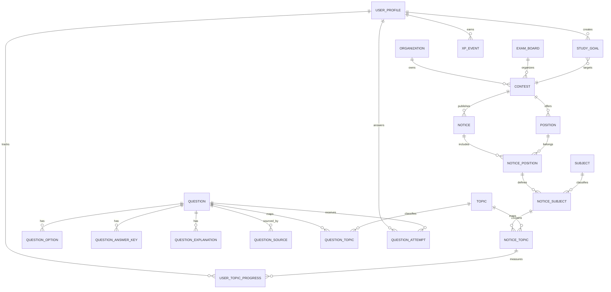

# Modelo de dados — visão conceitual

Este documento descreve entidades e relações esperadas. Ainda não é um schema SQL definitivo. O modelo será convertido em migrações após a aprovação da stack.

## 1. Identidade e acesso

### Auth identity
Identidade gerenciada pelo provedor de autenticação. Se Supabase Auth for escolhido, a identidade ficará no schema reservado `auth`; não duplicar senha ou hash de senha nas tabelas de domínio.

### UserProfile
Dados de produto associados ao identificador da identidade: nome público, apelido, biografia, avatar e timestamps.

### UserPreference
Preferências de estudo, notificações, tema e configurações pessoais.

### Role / Permission
Papéis e permissões administrativas. A autorização deve ser verificada no servidor e, se aplicável, reforçada por políticas RLS.

## 2. Catálogo de concursos

### Organization
Órgão ou instituição responsável.

### ExamBoard
Banca organizadora.

### Contest
Concurso, com órgão, situação e metadados.

### Position
Cargo relacionado ao concurso, com escolaridade, área e remuneração quando confirmadas.

### Notice
Edital e versão do documento, datas, origem e situação de publicação.

### NoticePosition
Associação entre edital e cargo, quando um edital abranger vários cargos.

## 3. Estrutura pedagógica

### Subject
Disciplina.

### Topic
Assunto, com possibilidade de hierarquia pai/filho para subassuntos.

### NoticeSubject
Associação do conteúdo programático a um edital/cargo e à disciplina.

### NoticeTopic
Associação do tópico ao conteúdo programático de um edital/cargo. Preservar a redação e a ordem de origem quando necessário; não assumir que todo tópico de catálogo se aplica a todos os editais.

## 4. Questões

### Question
Enunciado, tipo, dificuldade, estado editorial e classificação.

### QuestionOption
Alternativas ordenadas, quando aplicável.

### QuestionAnswerKey
Gabarito versionado e revisado. Alterações precisam manter trilha de auditoria.

### QuestionExplanation
Comentário, resolução e referências.

### QuestionSource
Origem, URL/documento, titularidade/licença, data de captura e condições de uso.

### QuestionTopic
Associação entre questão e assuntos.

### QuestionAttempt
Tentativa do usuário: resposta selecionada/textual, resultado calculado no servidor, duração, chave de idempotência e timestamp.

## 5. Objetivos, estudo e progresso

### StudyGoal
Objetivo de preparação do usuário, ligado a concurso/cargo e com estado ativo/arquivado.

### UserTopicProgress
Estado do usuário por tópico do edital: status, autoavaliação/domínio estimado, prioridade e última atividade.

### StudySession
Sessão de estudo com início, fim, duração e atividades associadas.

### Notebook / NotebookQuestion
Cadernos pessoais e associação de questões.

## 6. Métricas e gamificação

### XpRule
Regra versionada que determina elegibilidade e valor de XP.

### XpEvent
Evento de XP auditável, com origem, regra, usuário, valor e chave de idempotência.

### Achievement / UserAchievement
Definição de conquista e desbloqueio do usuário.

Níveis, ligas e snapshots de ranking ficam fora do MVP. XP deve ser derivado de eventos elegíveis, nunca de valor enviado pelo cliente.

## 7. Entidades futuras

Estas entidades não precisam ser implementadas no MVP:
- StudyPlan / StudyTask.
- Flashcard / FlashcardReview.
- MockExam / MockExamQuestion / MockExamAttempt.
- Follow / Friendship.
- Post / Comment / Reaction.
- StudyGroup / GroupMember / Challenge.
- Report / ModerationAction / Block.
- AiConversation / AiMessage.
- SubscriptionPlan / Subscription / Entitlement.
- PaymentEvent.

## 8. Relacionamentos principais

- Uma organização pode possuir vários concursos.
- Um concurso pode possuir vários cargos.
- Um concurso pode ter várias versões de edital.
- Um edital pode abranger vários cargos; a associação edital/cargo determina o conteúdo programático aplicável.
- Um edital/cargo possui disciplinas e tópicos ordenados.
- Questões podem se relacionar a vários tópicos e fontes.
- Usuários possuem objetivos, tentativas, sessões e progresso.
- Tentativas referenciam questão e usuário e não devem ser alteradas para recalcular silenciosamente o histórico.
- XP é registrado por eventos ligados a atividades verificáveis.

## 9. Diagrama conceitual simplificado

O diagrama é conceitual e não substitui constraints, índices, políticas de acesso ou o schema definitivo.

## 10. Regras de integridade

- IDs estáveis e chaves estrangeiras.
- Unicidade para eventos idempotentes.
- Timestamps consistentes e datas de publicação explícitas.
- Auditoria de alterações em gabaritos, permissões e conteúdo publicado.
- Separação entre conteúdo demonstrativo e conteúdo verificado.
- Restrições de acesso por usuário em todas as entidades privadas.
- Índices orientados a consultas reais, definidos após medir uso.
- Exclusão e retenção de dados conforme política de privacidade e obrigações aplicáveis.

## 11. Próxima etapa

Validar este modelo com os fluxos do MVP e produzir um ERD detalhado e migrações SQL. Não criar tabelas de módulos futuros apenas porque aparecem nesta visão.

## Implementação SQL inicial — catálogo e questões

A migração `supabase/migrations/0002_study_catalog_and_question_attempts.sql` implementa:
- `study_contests`, `study_notices`, `study_subjects`, `study_topics`, `study_notice_subjects`.
- `study_questions` e `study_question_options` com campos públicos limitados por grants de coluna.
- `study_question_answer_keys` sem leitura direta para `anon`/estudante.
- `student_contests` com RLS por `auth.uid()`.
- `question_attempts` com chave única `(user_id, idempotency_key)`, sem INSERT direto por cliente.
- RPC `submit_question_attempt` como única via de submissão, validação do gabarito e retorno de explicação após responder.
- Triggers para bloquear publicação de edital/questão sem seus pré-requisitos.

A migração é versionada no repositório, mas ainda não foi aplicada ao Supabase. O modelo só se torna operacional após provisionamento e testes reais.
